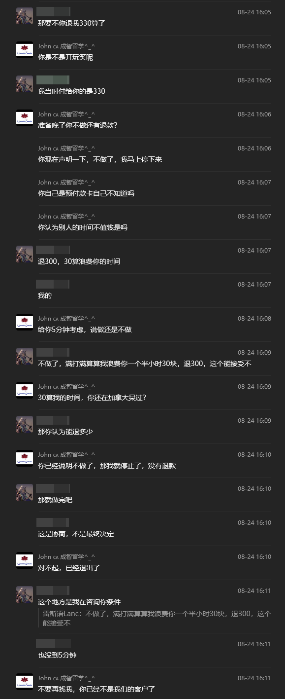

微信ID：iLiCJohn

微信名称：John 🇨🇦 成智留学^^_^^

收款邮箱：John.lee&#64;ilearnincanada.com

<!-- more -->

事件概述：

本人在与微信用户iLiCJohn（自称“成智留学”）协商学签续签服务过程中，遭遇其不透明收费、恶意扣款及拒绝退款的行为。对方在初期报价330加币全包服务，却在办理过程中额外索要150加币“签证申报费”，并在我提出质疑并协商取消服务时，以“时间已消耗”为由拒绝退款，甚至单方面终止服务并拉黑客户。

## 事件详细经过：

### 本人2025年3月在微信上联系iLiCJohn，询问学签续签服务价格。

对方明确表示：“如果是朋友推荐的，服务费用是$330”，并未提及任何额外费用。

基于这一报价，本人通过e-transfer于7月向John.lee&#64;ilearnincanada.com转账330加币。

对方告知我尚未进入加拿大境内，无法继续办理可以退款，我出于信任告知“你先收着吧，省的到时候再折腾了”。

### 2025年8月24日办理过程中突然加价

在提供全部所需身份材料后，对方突然告知330加币不包含“移民局申报费”150加币，要求额外支付。

本人提出质疑，认为价格不透明且总额过高（合计480加币，常见中介服务费在150~200加币之间），并尝试协商取消服务并退款。

### 恶意拒绝退款并威胁

对方以“时间已消耗”为由拒绝退款，声称“已经没有退款可能”。

甚至在本人提出协商方案（退300加币，扣30加币作为时间成本）后，对方态度强硬，单方面终止服务并称“不要再找我，你已经不是我们的客户”。并且拒绝继续进行办理。

对方没有提供合同，并且有充足理由怀疑其漏税。

## 最终结果

截至于2025年8月26日，服务未完成，330加币款项未退还，对方拒绝进一步沟通及继续办理。

已向加拿大反欺诈系统与微信安全进行报告

本人特意公开此事以避免更多人受害，网络交易有风险，转账需谨慎！